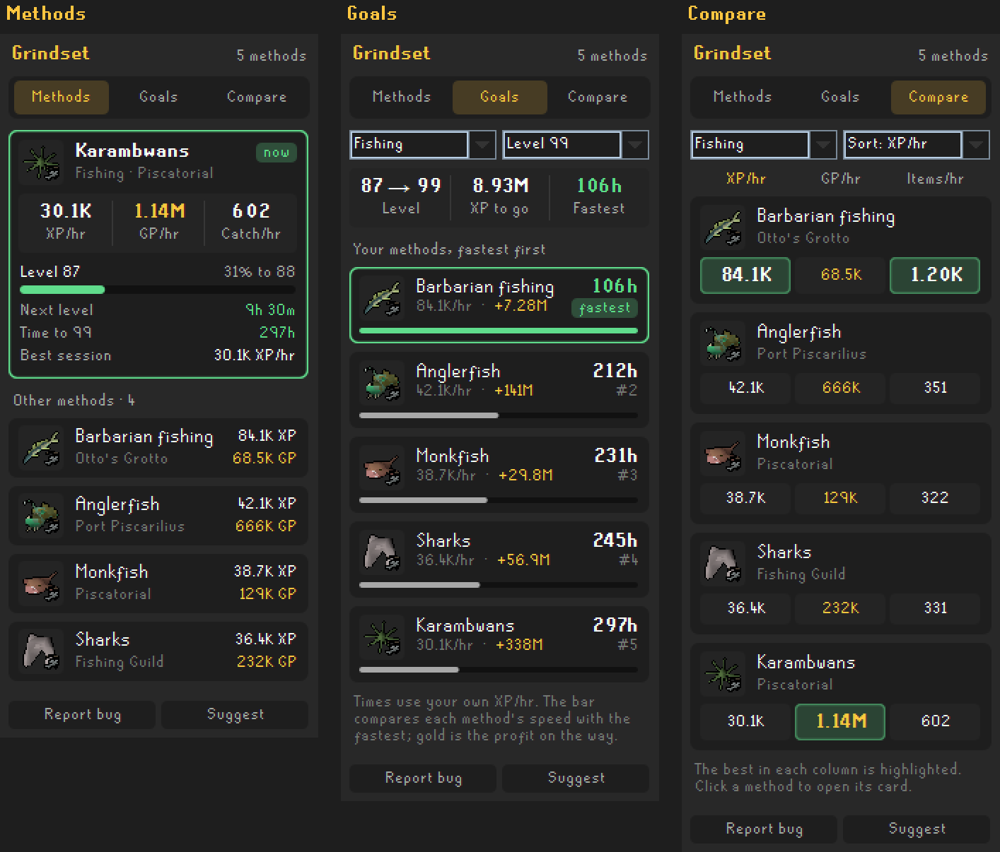

# Grindset

Skilling tracked **by method**, not by skill. Karambwans, barbarian fishing, Master Farmer pickpocketing and High Level Alchemy each get their own card, with your own rates.

## Three tabs

- **Methods:** a card for every method. The one you're doing is open at the top; the rest fold into one line each and open on a click.
- **Goals:** pick a skill and a level, and see how many hours of play each of your methods takes to get there, fastest first, with the profit you'd make on the way.
- **Compare:** a skill's methods side by side in XP/hr, GP/hr and items per hour, with the best in each column highlighted. Sort by any of the three.

The skill and level you pick on Goals and Compare are remembered. Click a method on either tab to open its card.

## Every card shows

- **Where you're doing it**, such as Piscatorial or Otto's Grotto, under the method's name.
- **XP/hr**, **GP/hr** and items per hour (catch, logs, ore, runes, made, used or actions).
- **GP/hr is profit:** what you make minus what you use up. Cooking, fletching and alching show real profit. Firemaking and Prayer show what they cost, in red.
- **Banking included:** GP/hr counts the whole trip and updates every 5 ticks. When banking makes a real difference, the card also shows the rate at the spot only.
- **Other skills it trains**, such as barbarian fishing's Agility and Strength, or the Mining and Crafting in Guardians of the Rift.
- **Time to your next level, to your Goals tab level and to 99** at that method's XP/hr, in hours of play.
- **Your level** and how far you are through it, as a bar.
- **Best session:** your best XP/hr for the method in one session of at least 10 minutes.
- **Recent trips:** your last three trips, each from leaving the bank to banking again, with how long it took, the XP and the profit.
- **Recent sessions:** your last five logins at the method (5 minutes or more), with hours of play and XP/hr, so you can see if you're getting faster.
- **Dropping:** power-chopping and 3-tick fishing are spotted, so the card says "dropping" instead of showing a made-up GP/hr.

## How methods are recognised

| Skills | Named by | Example |
|---|---|---|
| Fishing, Woodcutting, Mining, Hunter, Farming, Runecraft, Cooking, Smithing, Fletching, Crafting, Herblore | What you get | Karambwans, Teak logs, Cooked karambwan |
| Firemaking, Prayer, Construction | What you use up | Maple logs, Dragon bones, Mahogany plank |
| Thieving, non-combat Magic | What you click | Pickpocket Master Farmer, High Level Alchemy |
| Agility | The course | Seers' Village rooftops |

Guardians of the Rift, Wintertodt, Tempoross, Giants' Foundry, Hallowed Sepulchre, Volcanic Mine and the Motherlode Mine are tracked as minigames, including the rewards you collect afterwards. In a minigame's arena, all of its skills count towards it (Wintertodt's Woodcutting, Fletching and Construction go to Wintertodt), and finished games are counted for Games played and Games/hr.

Combat skills are left to combat trackers. Combat XP still counts when it comes with a skilling method, such as barbarian fishing's Strength.

## Overlay

The method you're doing is shown on screen with its XP/hr, GP/hr and time to your next level. It's on by default and can be turned off in the settings.

## Settings

- **Overlay:** on or off.
- **Remember methods:** keep them between sessions, separately for each account.
- **GP/hr price:** Grand Exchange or High Alchemy.
- **Count dropped items:** include the value of what you drop.

Right-click a card to **Hide**, **Reset stats** or **Remove** it.

## Privacy

Everything stays in your RuneLite settings. Nothing is sent anywhere.
